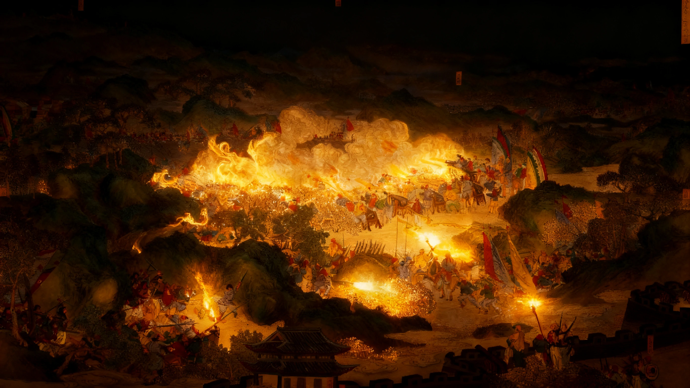
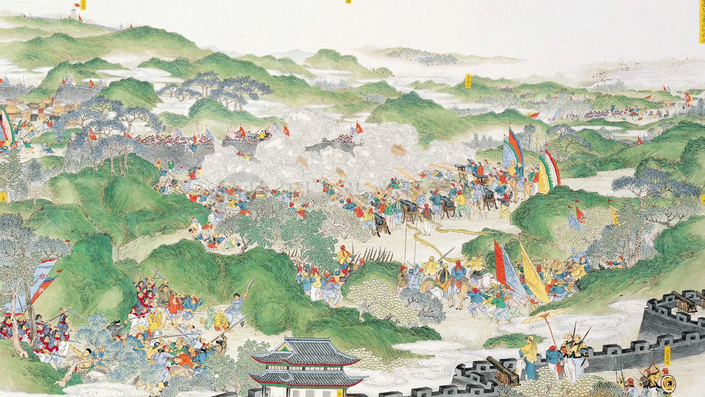

<section class="hero">
    

        

            
&nbsp;

            
00:0000

        

        <h1 class="hero-title">
            落日熔金， 暮云合璧
            人在何处
        </h1>

        
历史，你好！

        

            <form id="search-form" class="bing-search-form"
                  action="https://www.bing.com/search"
                  method="get" target="_blank" data-engine="bing">

                <button type="button" id="search-engine-switch" title="切换搜索引擎" aria-label="切换搜索引擎">
                    <svg class="search-engine-icon" id="icon-bing" xmlns="http://www.w3.org/2000/svg" width="20" height="20" viewBox="0 0 24 24"><path fill="currentColor" d="m10.833 3.065l4.333 2.253v13.5l-4.333 2.182l-5.62-3.248V6.29L10.833 3.065ZM6.21 6.556l4.623-2.67v13.5l-4.623-2.348V6.556Z"/></svg>
                    <svg class="search-engine-icon hidden" id="icon-google" xmlns="http://www.w3.org/2000/svg" width="18" height="18" viewBox="0 0 24 24"><path fill="currentColor" d="M21.35 11.1h-9.35v2.9h5.65q-.5 2.1-2.2 3.25t-4.1.25q-3.4 0-5.8-2.35t-2.4-5.65q0-3.3 2.4-5.65t5.8-2.35q1.7 0 3.25.75t2.55 2l2.2-2.2q-2.1-2-5.2-2q-4.4 0-7.5 3.15T3 12.05q0 4.4 3.15 7.55t7.55 3.15q4.1 0 6.8-2.8t2.7-6.8q0-.6-.05-1.1Z"/></svg>
                </button>

                <input id="search-input" type="text" name="q" placeholder="在必应上搜索" autocomplete="off" aria-label="搜索">
                <button type="submit" aria-label="搜索">
                    <svg xmlns="http://www.w3.org/2000/svg" viewBox="0 0 24 24" fill="none" stroke="currentColor" stroke-width="2.4" stroke-linecap="round" stroke-linejoin="round"><circle cx="11" cy="11" r="7"/><line x1="20" y1="20" x2="16.2" y2="16.2"/></svg>
                </button>
            </form>
        

    

</section>

<section class="showcase">
    

        
        
        <noscript></noscript>
    

    
《金陵各營屢捷解圍圖》

</section>
