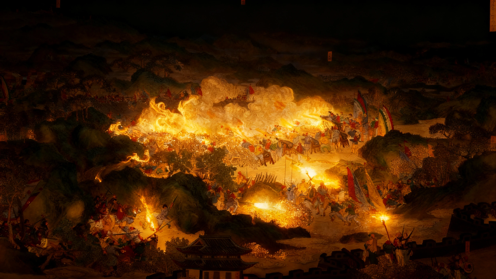
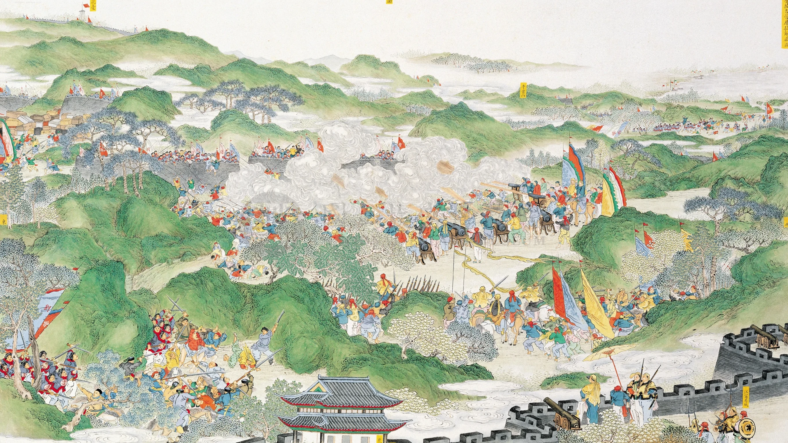

<section class="hero" id="hero">
    

        

            
            
            <noscript></noscript>
        

        

        

    

    <canvas id="ambient-canvas" class="ambient-canvas" aria-hidden="true"></canvas>

    

        

            

            

        

        <h1 class="hero-title">
            落日熔金， 暮云合璧
            人在何处
        </h1>

        

            <form id="search-form" class="bing-search-form"
                  action="https://www.bing.com/search"
                  method="get" target="_blank" data-engine="bing">

                <button type="button" id="search-engine-switch" title="当前：必应搜索（点击切换谷歌）" aria-label="当前：必应搜索，点击切换谷歌">
                    <svg class="search-engine-icon" id="icon-bing" xmlns="http://www.w3.org/2000/svg" width="20" height="20" viewBox="0 0 24 24"><path fill="currentColor" d="m10.833 3.065l4.333 2.253v13.5l-4.333 2.182l-5.62-3.248V6.29L10.833 3.065ZM6.21 6.556l4.623-2.67v13.5l-4.623-2.348V6.556Z"/></svg>
                    <svg class="search-engine-icon hidden" id="icon-google" xmlns="http://www.w3.org/2000/svg" width="18" height="18" viewBox="0 0 24 24"><path fill="currentColor" d="M21.35 11.1h-9.35v2.9h5.65q-.5 2.1-2.2 3.25t-4.1.25q-3.4 0-5.8-2.35t-2.4-5.65q0-3.3 2.4-5.65t5.8-2.35q1.7 0 3.25.75t2.55 2l2.2-2.2q-2-2-5.2-2q-4.4 0-7.5 3.15T3 12.05q0 4.4 3.15 7.55t7.55 3.15q4.1 0 6.8-2.8t2.7-6.8q0-.6-.05-1.1Z"/></svg>
                </button>

                <input id="search-input" type="text" name="q" placeholder="在必应上搜索" autocomplete="off" aria-label="搜索">
                <button type="submit" aria-label="搜索">
                    <svg xmlns="http://www.w3.org/2000/svg" viewBox="0 0 24 24" fill="none" stroke="currentColor" stroke-width="2.4" stroke-linecap="round" stroke-linejoin="round"><circle cx="11" cy="11" r="7"/><line x1="20" y1="20" x2="16.2" y2="16.2"/></svg>
                </button>
            </form>
        

        

            按 <kbd>/</kbd> 随时聚焦搜索 · <kbd>Esc</kbd> 清空
            <button type="button" class="onboard-dismiss" id="onboard-dismiss" aria-label="知道了">知道了</button>
        

    

    <nav class="hero-tags" aria-label="常用入口">
        <a href="resources/" class="hero-tag hero-tag--tl" data-lerp="0.025">
            
                <svg xmlns="http://www.w3.org/2000/svg" viewBox="0 0 24 24" fill="none" stroke="currentColor" stroke-width="1.8" stroke-linecap="round" stroke-linejoin="round"><path d="M4 19.5A2.5 2.5 0 0 1 6.5 17H20"/><path d="M6.5 2H20v20H6.5A2.5 2.5 0 0 1 4 19.5v-15A2.5 2.5 0 0 1 6.5 2z"/></svg>
            
            资源指北
        </a>
        <a href="tools/" class="hero-tag hero-tag--tr" data-lerp="0.048">
            
                <svg xmlns="http://www.w3.org/2000/svg" viewBox="0 0 24 24" fill="none" stroke="currentColor" stroke-width="1.8" stroke-linecap="round" stroke-linejoin="round"><rect x="3" y="3" width="7" height="7" rx="1"/><rect x="14" y="3" width="7" height="7" rx="1"/><rect x="3" y="14" width="7" height="7" rx="1"/><rect x="14" y="14" width="7" height="7" rx="1"/></svg>
            
            工具箱
        </a>
        <a href="blog/" class="hero-tag hero-tag--bl" data-lerp="0.04">
            
                <svg xmlns="http://www.w3.org/2000/svg" viewBox="0 0 24 24" fill="none" stroke="currentColor" stroke-width="1.8" stroke-linecap="round" stroke-linejoin="round"><path d="M12 20h9"/><path d="M16.5 3.5a2.121 2.121 0 1 1 3 3L7 19l-4 1 1-4Z"/></svg>
            
            随笔
        </a>
        <a href="tools/zombicide_deck.html" class="hero-tag hero-tag--br" data-lerp="0.03" target="_blank" rel="noopener">
            
                <svg xmlns="http://www.w3.org/2000/svg" viewBox="0 0 24 24" fill="none" stroke="currentColor" stroke-width="1.8" stroke-linecap="round" stroke-linejoin="round"><rect x="4" y="2" width="12" height="18" rx="2"/><path d="M8 6h10a2 2 0 0 1 2 2v12a2 2 0 0 1-2 2H8"/></svg>
            
            工具
            &#8599;
        </a>
    </nav>

    

        背景画卷：《金陵各營屢捷解圍圖》 · 清
        <button type="button" class="showcase-theme-btn" id="showcase-theme-btn">切换昼夜画卷</button>
    

</section>
